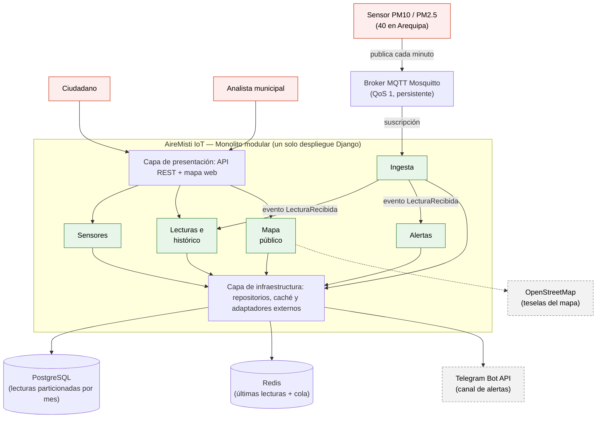
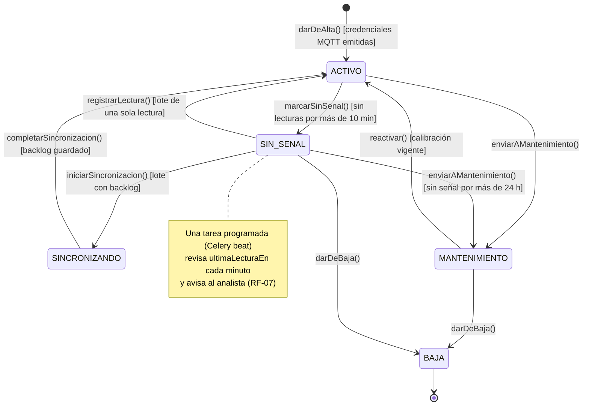
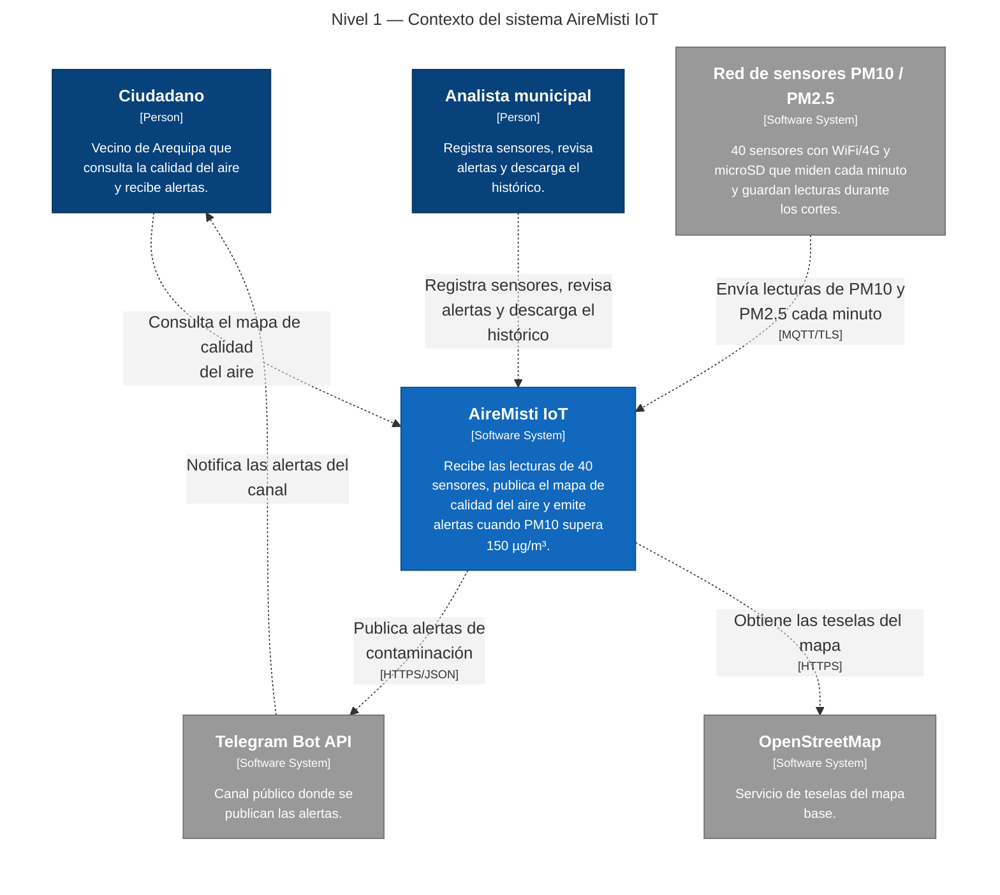
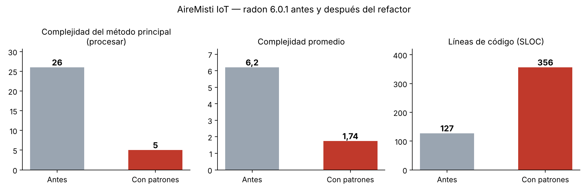
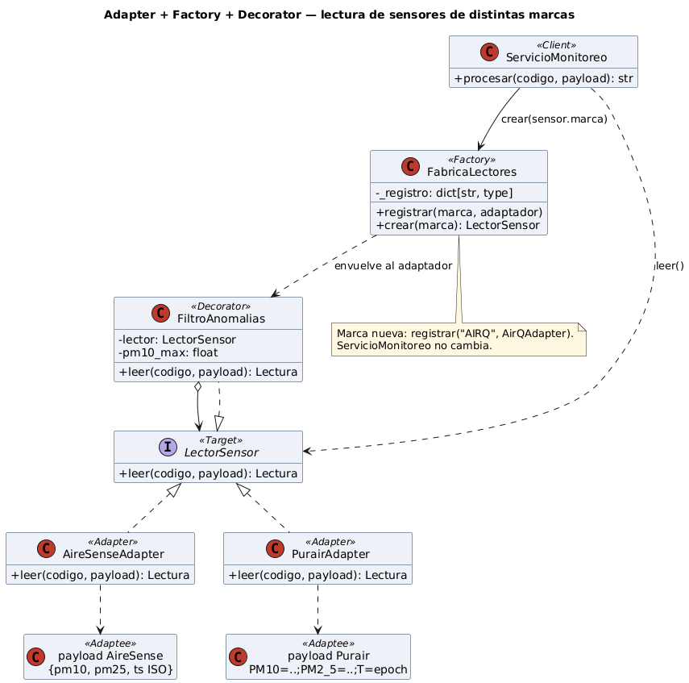
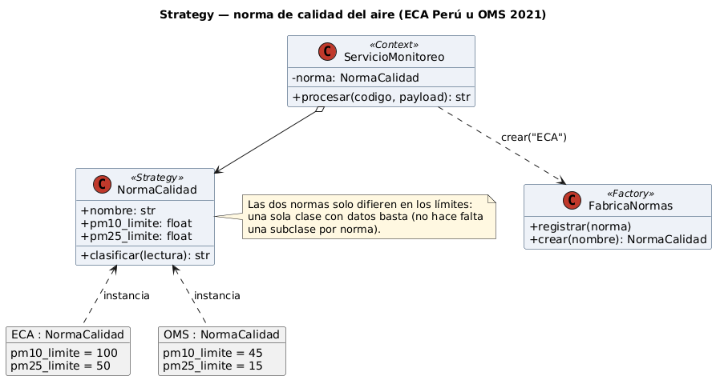
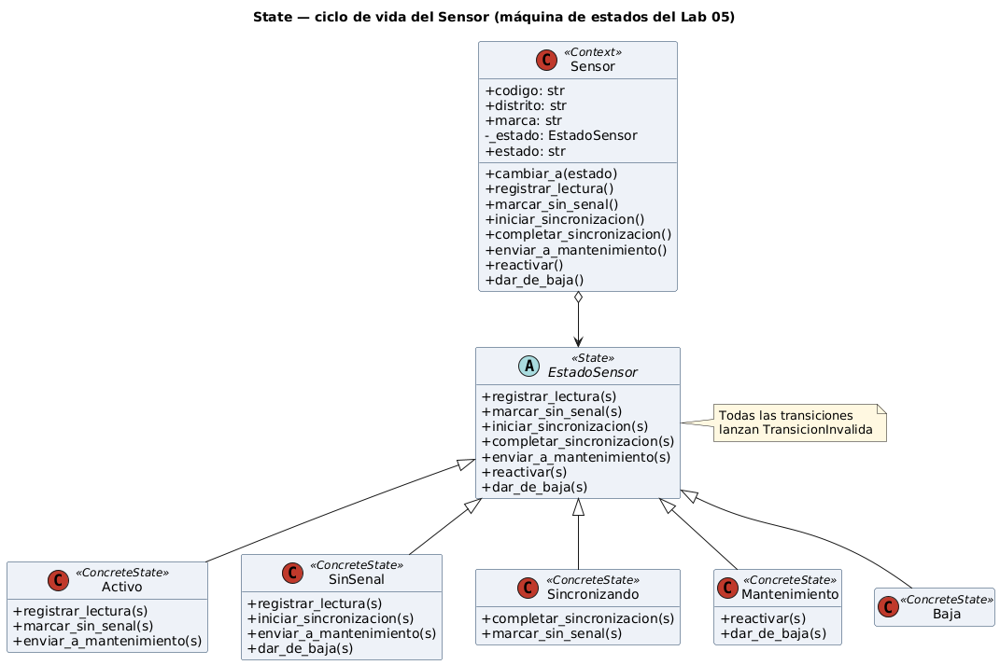
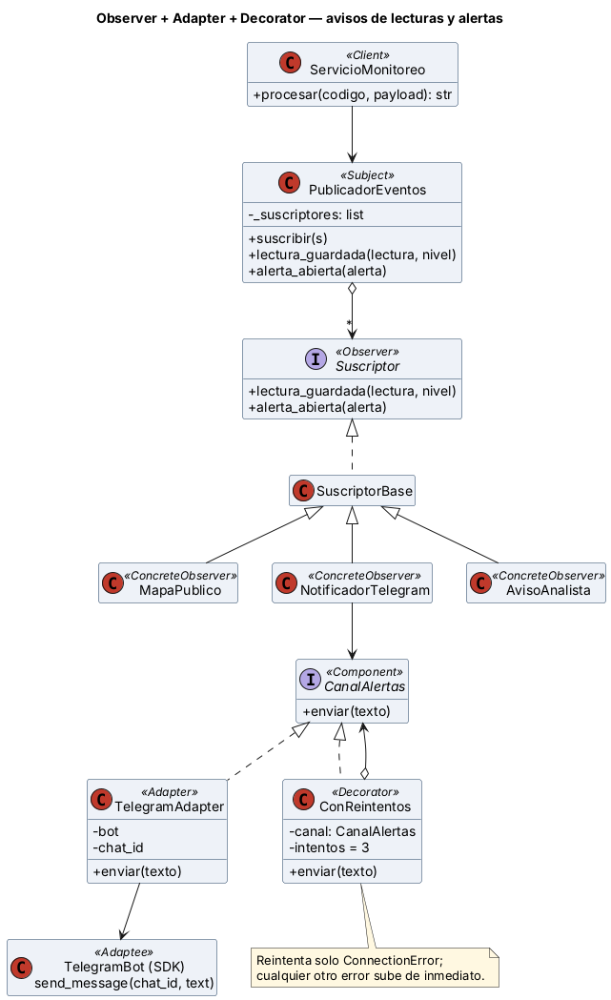
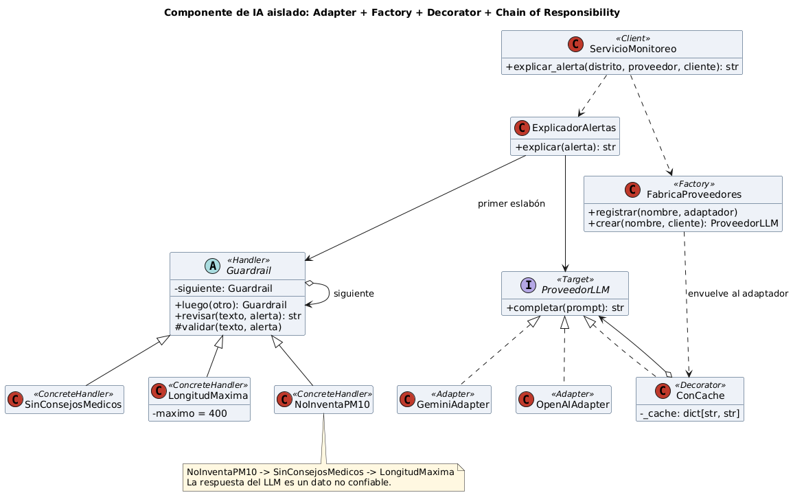

# AireMisti IoT — Laboratorio 04: Fundamentos de arquitectura de software
Construcción de Software · EPIS-UNSA · 2026-B

## Integrantes
| Nombre | Rol en el laboratorio |
|--------|-----------------------|
| Guillén Valcárcel, Daniel Josué | Diagramador (Mermaid, PlantUML, Python Diagrams) y redactor de ADR |
| Mengoa Valeriano, Brigitte Noelia | Analista de drivers y matriz de decisión, verificadora de IA |

## Caso
AireMisti IoT es una red de 40 sensores de calidad del aire (PM10 y PM2.5) instalados en Arequipa. Cada sensor envía una lectura por minuto; los ciudadanos consultan un mapa en tiempo real, el sistema emite una alerta pública cuando PM10 supera 150 µg/m³ y el analista municipal descarga el histórico.
**Atributo de calidad crítico:** ingesta y fiabilidad. No se debe perder ninguna lectura ante cortes de red de hasta 2 horas, gracias al almacenamiento local en el sensor.

## Arquitectura elegida
Monolito modular en Django con broker MQTT (4,50 en la matriz de decisión).



## Documentación
- [Drivers y escenarios de calidad](docs/architecture/drivers.md)
- [Matriz de decisión](docs/architecture/matriz-decision.md)
- [Bitácora de uso de IA](docs/architecture/bitacora-ia.md)
- Alternativa descartada: [alternativa.puml](docs/architecture/diagramas/alternativa.puml)
- Vista de despliegue: [despliegue.py](docs/architecture/diagramas/despliegue.py)

## Decisiones arquitectónicas
- [ADR-001: Estilo arquitectónico — monolito modular con broker MQTT](docs/architecture/adr/001-estilo-arquitectonico.md)
- [ADR-002: Almacenamiento de lecturas en PostgreSQL particionado](docs/architecture/adr/002-almacenamiento-lecturas.md)
- [ADR-003: Ingesta por MQTT con QoS 1 y credenciales por sensor](docs/architecture/adr/003-protocolo-ingesta.md)
- [ADR-005: Patrones de diseño en el flujo de lecturas y alertas](docs/architecture/adr/005-patrones-de-diseno.md)

## Diseño UML (Lab 05)
Diseño detallado de la historia crítica [HU-03: ingesta de una lectura y emisión de alerta](docs/design/historia.md), coherente con el ADR-001.

### Máquina de estados del Sensor


### Diagramas
| Diagrama | Código | Imagen |
|---|---|---|
| Clases (E1) | [clases.puml](docs/design/clases.puml) | [PNG](docs/design/img/clases.png) |
| Secuencia (E2) | [secuencia-ingesta-alerta.puml](docs/design/secuencia-ingesta-alerta.puml) | [PNG](docs/design/img/secuencia-ingesta-alerta.png) |
| Estados (E3) | [estados-sensor.mmd](docs/design/estados-sensor.mmd) | [PNG](docs/design/img/estados-sensor.png) |
| Actividades (E4) | [actividades-emitir-alerta.puml](docs/design/actividades-emitir-alerta.puml) | [PNG](docs/design/img/actividades-emitir-alerta.png) |
| Paquetes (E5) | [paquetes.puml](docs/design/paquetes.puml) | [PNG](docs/design/img/paquetes.png) |
| Ingeniería inversa (E6) | [classes_airemisti.puml](docs/design/classes_airemisti.puml) | [PNG](docs/design/img/classes_airemisti.png) |

### Documentos
- [Round-trip diagrama ↔ código](docs/design/round-trip.md) y esqueleto en [`src/airemisti/`](src/airemisti)
- [Revisión de consistencia C1–C5](docs/design/consistencia.md)
- [Bitácora de IA del Lab 05](docs/design/bitacora-ia.md)

Pruebas: `PYTHONPATH=src pytest tests` (criterios de HU-03 y una prueba por transición del Sensor).

## Arquitectura C4 (Lab 06)
Modelo único en Structurizr DSL ([workspace.dsl](docs/architecture/c4/workspace.dsl)); las cinco vistas se exportan desde él a C4-PlantUML y Mermaid.

### Nivel 1 — Contexto del sistema


### Vistas
| Vista | Imagen | Exportado |
|---|---|---|
| Nivel 1 — Contexto | [PNG](docs/architecture/c4/img/structurizr-Contexto.png) | [.puml](docs/architecture/c4/export/structurizr-Contexto.puml) · [.mmd](docs/architecture/c4/export/structurizr-Contexto.mmd) |
| Nivel 2 — Contenedores | [PNG](docs/architecture/c4/img/structurizr-Contenedores.png) | [.puml](docs/architecture/c4/export/structurizr-Contenedores.puml) · [.mmd](docs/architecture/c4/export/structurizr-Contenedores.mmd) |
| Nivel 3 — Componentes del Monolito Django | [PNG](docs/architecture/c4/img/structurizr-Componentes.png) | [.puml](docs/architecture/c4/export/structurizr-Componentes.puml) · [.mmd](docs/architecture/c4/export/structurizr-Componentes.mmd) |
| Dinámica — Ingesta y alerta | [PNG](docs/architecture/c4/img/structurizr-IngestaYAlerta.png) | [.puml](docs/architecture/c4/export/structurizr-IngestaYAlerta.puml) · [.mmd](docs/architecture/c4/export/structurizr-IngestaYAlerta.mmd) |
| Despliegue — Producción | [PNG](docs/architecture/c4/img/structurizr-Despliegue.png) | [.puml](docs/architecture/c4/export/structurizr-Despliegue.puml) · [.mmd](docs/architecture/c4/export/structurizr-Despliegue.mmd) |

El nivel 4 (código) no se vuelve a dibujar: es el [diagrama de clases del Lab 05](docs/design/clases.puml).

### Documentos
- [Inventario de elementos](docs/architecture/c4/inventario.md)
- [Comparaciones: vista dinámica vs. secuencia UML y modelo vs. diagrama a mano](docs/architecture/c4/comparacion.md)
- [Revisión con la lista oficial de C4 y con IA](docs/architecture/c4/revision-c4.md)
- [Explicación para público no técnico](docs/architecture/c4/explicacion.md)
- [Bitácora de IA del Lab 06](docs/architecture/c4/bitacora-ia.md)

La GitHub Action valida `workspace.dsl` con Structurizr CLI en cada push que lo modifica (falla si el modelo tiene errores) y regenera las imágenes.

## Patrones de diseño (Lab 07)

Se refactorizó el flujo crítico del Lab 05, **procesar una lectura y emitir la alerta**, en `src/monitoreo/`.
La versión ingenua se conserva en `src/monitoreo/antes/servicio.py` y las mismas pruebas de caracterización
corren sobre las dos versiones. Los servicios externos (Telegram, OpenAI, Gemini) están simulados en `externos.py`.

```bash
pip install pytest radon
PYTHONPATH=src pytest tests                         # 85 passed, 1 xfailed
radon cc -s -a src/monitoreo -e "*/antes/*,*/externos.py"
```

### Olor → patrón → prueba

| Olor en la versión antes | Patrón | Archivo | Prueba que lo demuestra |
|---|---|---|---|
| `if/elif` por marca de sensor | Adapter + Factory | `sensores.py` | `test_marca_nueva_se_registra_sin_tocar_el_servicio` |
| Validación de anomalías mezclada con el parseo | Decorator `FiltroAnomalias` | `sensores.py` | `test_filtro_de_anomalias_es_configurable` |
| `if/elif` por norma ECA/OMS | Strategy `NormaCalidad` | `indices.py` | `test_norma_nueva_se_agrega_sin_tocar_el_servicio` |
| Condicionales sobre `sensor.estado` | State | `estados.py` | `test_transiciones_fuera_del_diagrama_fallan` |
| El servicio llama a mano al mapa, Telegram y analista | Observer | `eventos.py` | `test_suscriptor_nuevo_recibe_las_alertas` |
| Bucle de reintentos dentro del flujo | Decorator `ConReintentos` | `eventos.py` | `test_reintentos_no_ocultan_errores_que_no_son_de_red` |
| `if/elif` por proveedor de LLM | Adapter + Factory `ProveedorLLM` | `ia.py` | `test_ia_explica_la_alerta_con_cualquier_proveedor` |
| Prompt repetido se paga dos veces | Decorator `ConCache` | `ia.py` | `test_cache_evita_pagar_dos_veces_el_mismo_prompt` |
| Validaciones de la respuesta del LLM en línea | Chain of Responsibility | `ia.py` | `test_guardrails_bloquean_respuestas_inseguras_de_la_ia` |

Error encontrado por las pruebas: en la versión antes, un sensor `SIN_SENAL` pasaba a `ACTIVO` aunque su
payload no se pudiera leer (`test_payload_invalido_no_reactiva_un_sensor_sin_senal`, `xfail` en antes).

### Métricas (radon 6.0.1)

| | Antes | Con patrones |
|---|:---:|:---:|
| Complejidad de `procesar` | 26 (D) | 5 (A) |
| Complejidad máxima | 26 (D) | 6 (B) |
| Complejidad promedio | 6,2 (B) | 1,74 (A) |
| SLOC | 127 | 356 |
| Archivos | 1 | 6 |



Ganamos un servicio que no cambia al agregar marcas, normas, avisos o proveedores de IA; pagamos con casi el
triple de líneas y más indirección. Patrones rechazados: Singleton, Proxy, Abstract Factory y LLM como juez
(ver [metricas.md](docs/design/patrones/metricas.md) y [ADR-005](docs/architecture/adr/005-patrones-de-diseno.md)).

### Diagramas

| Adapter + Factory + Decorator | Strategy | State |
|---|---|---|
|  |  |  |

| Observer + Decorator | IA: Adapter + Decorator + Chain |
|---|---|
|  |  |

Colaboración en `procesar()`: [secuencia-patrones.puml](docs/design/patrones/secuencia-patrones.puml).
El diagrama de clases del Lab 05 ([clases.puml](docs/design/clases.puml)) se actualizó y se verificó con pyreverse
([verificacion-pyreverse.md](docs/design/patrones/verificacion-pyreverse.md)).

### Documentos
- [Olores detectados y decisión](docs/design/patrones/olores.md)
- [Métricas y trade-off](docs/design/patrones/metricas.md)
- [Bitácora de IA del Lab 07](docs/design/patrones/bitacora-ia.md)
- [ADR-005: patrones de diseño](docs/architecture/adr/005-patrones-de-diseno.md)

### Integración continua (reto B)
La Action [`pruebas.yml`](.github/workflows/pruebas.yml) ejecuta `pytest` en cada push y Pull Request y falla si
algún método de `src/monitoreo` (sin contar la versión antes) llega a complejidad 11 o más (`radon cc --min C`).

## Reflexión sobre el uso de la IA
La IA aceleró la exploración: en minutos generó tres alternativas, los borradores de los diagramas y de los ADR, y su papel de "abogado del diablo" nos mostró riesgos que no habíamos considerado, como la pérdida de mensajes si el broker se reinicia.
Sin embargo, mostró un sesgo hacia tecnologías de moda: recomendó Kafka para 40 sensores, cuando un cálculo simple muestra apenas 0,67 lecturas por segundo.
También inventó datos: una clase Mosquitto inexistente en la librería diagrams y que QoS 2 evita toda pérdida aunque el broker no tenga persistencia.
Aprendimos a verificar cada afirmación contra la documentación oficial, a recalcular las cifras y a contrastar toda propuesta con nuestras restricciones (R-01 a R-05).
La IA propone; las decisiones y su justificación quedaron a cargo del equipo.
