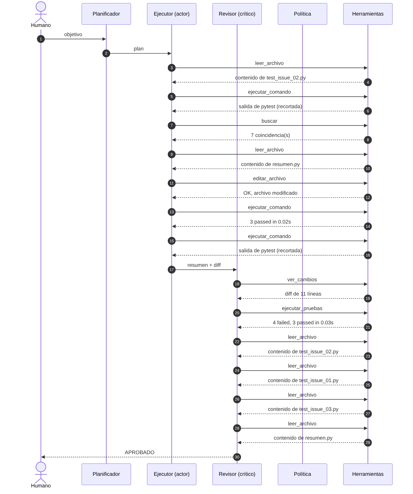

# E7. Observación de las trazas

Métricas obtenidas de `trazas/<corrida>/*.jsonl` con `python agente/traza.py trazas/<corrida>`; el contexto final lo imprime `orquestador.py` (caracteres del historial; tokens ≈ caracteres / 4). El historial incluye la salida de pytest, con la ruta del sandbox y los tiempos: al reproducir en otra carpeta el contexto varía unas decenas de caracteres.

| Issue | Variante | Pasos | Rondas | Herramientas usadas (veces) | Rechazos del contrato | Acciones bloqueadas | Contexto final |
|---|---|---|---|---|---|---|---|
| ISSUE-01 (E2) | Agente único | 8 | — | leer_archivo 3, ejecutar_comando 2, editar_archivo 1, ejecutar_pruebas 1 | 0 | 0 | 14 410 (~3602 tokens) |
| ISSUE-03 (E4) | Agente único + `mapa_repo` y notas | 9 | — | leer_archivo 3, mapa_repo 1, buscar 1, editar_archivo 1, ejecutar_pruebas 1, ejecutar_comando 1 | 0 | 0 | 15 138 (~3784 tokens) |
| ISSUE-02 (E5) | Agente único | 8 | — | leer_archivo 3, ejecutar_comando 2, editar_archivo 1, ejecutar_pruebas 1 | 0 | 0 | 13 696 (~3424 tokens) |
| ISSUE-02 (E5) | Planificador + actor-crítico | 16 | 1 de 2 | ejecutor: ejecutar_comando 3, leer_archivo 2, buscar 1, editar_archivo 1; revisor: leer_archivo 4, ver_cambios 1, ejecutar_pruebas 1 | 0 | 0 | ejecutor 20 228; revisor 16 628; total 39 739 |
| ISSUE-02 (Reto A) | Planificador + ejecutor + 3 revisores | 24 | 1 de 2 | revisores: leer_archivo 5, ver_cambios 3, ejecutar_pruebas 3, buscar 1 (ejecutor igual al anterior) | 0 | 0 | total 57 437 |

Los tres issues quedaron resueltos: la prueba de cada issue pasa en el sandbox, ningún agente modificó `tests/` y el cambio aprobado se aplicó a `src/airemisti/reportes/resumen.py` con la prueba sin marca `xfail` en `tests/`.

## Trayectoria del actor-crítico (ISSUE-02)

## Análisis
- **Contrato y política sin disparos.** El modelo respondió siempre con el JSON del protocolo y nunca pidió una herramienta o comando fuera de su política, así que en las corridas hubo 0 rechazos y 0 bloqueos. El contrato y la política se comprobaron con decisiones inválidas propias en `pruebas_agente/` (E3): dos de ellas (`final` con campos de más y `accion` como lista) pasaban o rompían el contrato original y obligaron a corregirlo.
- **Una herramienta mal diseñada cuesta pasos.** `ejecutar_pruebas` devuelve las primeras 6 líneas `E ...` y el total, pero no los nombres de las pruebas que fallan. Los tres agentes únicos gastaron un paso extra en `python -m pytest -rf` o `-rA` solo para saber qué pruebas fallaban, y el revisor del actor-crítico leyó las pruebas de los issues 1 y 3 por la misma razón (2 de sus 6 acciones). Mejora pendiente: listar primero las líneas `FAILED`.
- **E4: `mapa_repo` y notas no redujeron el costo aquí.** El issue 3 tomó 9 pasos y 15 138 caracteres frente a 8 pasos y 14 410 del issue 1 en E2. `mapa_repo` mostró la clase y las 4 funciones de `resumen.py` con su línea y llevó al agente directo a `promedio` (línea 39), pero igual tuvo que leer el archivo para editarlo. El agente no usó `anotar` ni `leer_notas`: con un solo archivo implicado no tenía nada que recordar. Las dos herramientas rinden en tareas con varios archivos, no en este módulo de 60 líneas.
- **E5: el crítico no encontró nada nuevo.** Ver [coordinacion.md](coordinacion.md): mismo cambio, doble de pasos y 2,9 veces el contexto.
- **Reto A: tres revisores, el mismo veredicto.** Los tres aprobaron por unanimidad. Cada foco revisó algo distinto: corrección buscó todos los usos de `sin_duplicados`, diseño comparó el cambio con el docstring y con el issue, y seguridad revisó solo el diff y las pruebas (3 pasos). Ninguno encontró un defecto. Costo: 1,45 veces el contexto del actor-crítico y 4,2 veces el del agente único.
- **Intervención humana que falta.** Aprobar el PR. En E6 un integrante aprueba en consola cada edición del ejecutor.
