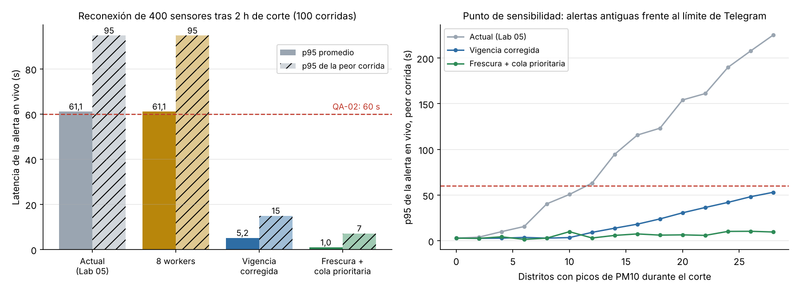

# Iteración 1 de ADD — Rendimiento de las alertas durante la reconexión masiva (QA-02 y QA-05)

## 1. Entradas revisadas
| Insumo | Origen | Qué aporta |
|---|---|---|
| Drivers y restricciones | [drivers.md](../drivers.md) | 1 mes (R-01), 2 developers con Python/PostgreSQL (R-02), un VPS (R-03) |
| Estilo | [ADR-001](../adr/001-estilo-arquitectonico.md) | Monolito modular con broker MQTT; no se cambia sin evidencia |
| Ingesta y almacenamiento | [ADR-002](../adr/002-almacenamiento-lecturas.md), [ADR-003](../adr/003-protocolo-ingesta.md) | Lotes con `ON CONFLICT DO NOTHING`, QoS 1 y sesión persistente |
| Modelo C4 | [workspace.dsl](../c4/workspace.dsl) | Contenedores: broker, monolito (ingesta), worker Celery, Redis, PostgreSQL |
| Patrones | [ADR-005](../adr/005-patrones-de-diseno.md) | Observer y Decorator para los avisos |

## 2. Objetivo de la iteración
- **QA-02 (H,H):** una lectura en vivo con PM10 > 150 µg/m³ se publica en el canal en ≤ 60 s (p95) aunque 400 sensores estén reenviando su backlog.
- **QA-05 (H,M):** el backlog de 48 000 lecturas se guarda en ≤ 5 min.

## 3. Elemento que se refina
El camino de la alerta: **Ingesta** (monolito) → **cola de Celery en Redis** → **Worker** → **Telegram Bot API**.

## 4. Conceptos de diseño evaluados (Prompt IA 2)
| Concepto | Táctica (Bass et al.) | Qué mejora | Qué empeora | Decisión |
|---|---|---|---|---|
| Migrar a microservicios con Kafka o un clúster EMQX | Aumentar recursos / replicar | Capacidad de mensajes | Plazo, presupuesto y experiencia del equipo (R-01 a R-03) | **Rechazada:** el broker medido acepta 4700–5300 mensajes/s y la red genera 6,7/s; el cuello de botella no está ahí |
| Pasar de 2 a 8 workers de Celery | Introducir concurrencia | Tareas en paralelo | Más memoria en el VPS | **Rechazada:** la simulación da el mismo p95 (61 s); el límite es el canal de Telegram (20 mensajes/min) |
| Corregir `Alerta.extender` para que una lectura antigua no acorte la vigencia | Reducir la demanda (eliminar eventos repetidos) | Menos mensajes repetidos al canal | Nada | **Aceptada:** era un error real; el backlog republicaba la misma alerta |
| Clasificar por frescura: los picos con más de 10 min van a la cola `historico` (aviso al analista) y los frescos a la cola `alertas` | Priorizar eventos | Las alertas en vivo no esperan detrás del backlog | Un pico ocurrido durante el corte ya no se publica: solo lo ve el analista | **Aceptada** |
| Insertar el backlog fila por fila en lugar de por lotes | — | — | 8,9 ms frente a 2,4 ms por lote de 120 (medido) | Se mantiene la inserción por lotes de ADR-002 |

## 5. Elementos instanciados
- `ServicioIngesta._encolar_picos` separa picos frescos y antiguos (`VENTANA_ALERTA_PUBLICA = 10 min` en `compartido/parametros.py`). Un mensaje de una sola lectura siempre es en vivo (mitiga R6 del ATAM-lite).
- `Alerta.extender` usa `max(vigente_hasta, medido_en + 1 h)`.
- Dos colas de Celery: `alertas` con un worker dedicado y `historico` para el analista.

## 6. Evidencia
**Simulación de eventos discretos** ([fitness/alertas.py](../../../fitness/alertas.py)), 100 corridas con semillas distintas.

Supuestos:
- 400 sensores en 29 distritos; reconectan en una ventana de 60 s tras un corte de 2 h; cada uno manda su backlog en un mensaje y luego una lectura por minuto.
- Durante el corte hubo picos en 14 distritos (60 % de sus sensores los registraron); en 3 distritos el episodio sigue en vivo.
- Ingesta: lote de 120 lecturas con mediana de 6 ms y lectura suelta de 1 ms. Se midió en PostgreSQL 16 con 2,88 millones de filas ([calibrar_bd.py](../../../fitness/calibrar_bd.py)): 2,4 ms por lote con `execute_values` y 0,34 ms por lectura suelta, y se duplicó por el ORM de Django.
- Worker: 20 ms por evaluación. Telegram: 20 mensajes por minuto al mismo grupo o canal (FAQ de bots de Telegram).

| Política | p95 promedio | p95 de la peor corrida | Mensajes al canal | Backlog guardado |
|---|:---:|:---:|:---:|:---:|
| Actual (Lab 05) | 61,1 s | 95 s | 47,5 | 60 s |
| 8 workers | 61,1 s | 95 s | 47,5 | 60 s |
| Vigencia corregida | 5,2 s | 15 s | 15,5 | 60 s |
| **Frescura + cola prioritaria** | **1,0 s** | **7 s** | **8,7** | **60 s** |

**Punto de sensibilidad (gráfico derecho):** con la política actual, el p95 crece con el número de distritos que tuvieron picos durante el corte y supera 60 s desde 12 distritos, porque cada alerta antigua ocupa un turno de 3 s en el canal. Con la política adoptada la curva queda plana.

**Límite de la táctica:** si el episodio sigue **en vivo** en todos los distritos a la vez, el canal vuelve a ser el cuello de botella: el p95 de la peor corrida es de 46 s con 20 distritos y de 63 s con 29. Se registra como riesgo R2 en el [ATAM-lite](../atam-lite.md).

## 7. ¿Se cumple el escenario?
- **QA-02: sí.** p95 de 1,0 s y peor corrida de 7 s, frente a 60 s.
- **QA-05: sí.** El backlog se guarda en el tiempo que tardan los sensores en reconectar (60 s). Incluso si los 400 reconectan en el mismo instante, la ingesta lo procesa en ~2,4 s. El monolito con una sola ingesta es un **no riesgo**.
- Queda como prueba en la integración continua: FF-05 y FF-06 en [tests/test_fitness.py](../../../tests/test_fitness.py). La decisión se registra en el [ADR-006](../adr/006-alertas-frescas-y-cola-prioritaria.md).
