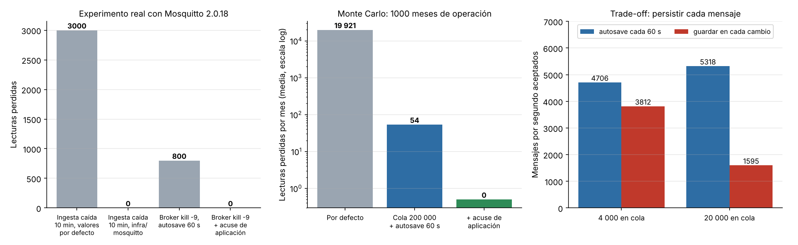

# Iteración 2 de ADD — Cero lecturas perdidas ante caídas de la ingesta o del broker (QA-03 y QA-01)

## 1. Entradas revisadas
[ADR-003](../adr/003-protocolo-ingesta.md) (QoS 1, sesión persistente y `persistence true`), los escenarios QA-01 y QA-03 del
[árbol de utilidad](../utilidad/escenarios.md) y la vista de contenedores ([workspace.dsl](../c4/workspace.dsl)).

## 2. Objetivo
- **QA-03 (H,H):** 0 lecturas perdidas si la ingesta cae 10 min o si el broker muere con `kill -9`.
- **QA-01 (H,M):** 0 lecturas perdidas y 0 duplicadas cuando un sensor reenvía 120 lecturas tras un corte de 2 h.

## 3. Elemento que se refina
El **Broker MQTT** (Mosquitto) y el protocolo entre el sensor, el broker y el proceso de ingesta.

## 4. Conceptos de diseño evaluados
| Concepto | Táctica | Qué mejora | Qué empeora | Decisión |
|---|---|---|---|---|
| Mantener la configuración del Lab 04 (QoS 1 y `persistence true`) | — | Nada nuevo | — | **Rechazada:** Mosquitto guarda como máximo 1000 mensajes por cliente desconectado. Con 40 sensores eso eran 25 min de caída de la ingesta; con 400 son solo 2,5 min. Medido: **3000 de 4000** lecturas perdidas en una caída de 10 min |
| Ampliar la cola (`max_queued_messages 200000`) | Mantener múltiples copias / colas | Cubre 8 h de caída de la ingesta | Más memoria en el broker mientras la ingesta está caída | **Aceptada** |
| Guardar en disco en cada cambio (`autosave_on_changes`) | Persistencia | El broker no pierde nada al morir | Medido: con 20 000 mensajes en cola el broker baja de 5318 a 1595 mensajes/s (−70 %) | **Rechazada:** el costo crece con la cola, justo durante una caída larga |
| Acuse de aplicación: la ingesta publica `airemisti/<sensor>/ack` después del `COMMIT` y el sensor borra de su microSD solo lo confirmado | Detectar y recuperar: reintento con confirmación de extremo a extremo | Ninguna caída del broker pierde lecturas; el reenvío es idempotente por ADR-002 | Un mensaje extra por lote; el sensor guarda las lecturas más tiempo | **Aceptada** junto con `autosave_interval 60` |
| Broker en clúster (EMQX o un puente Mosquitto en un segundo VPS) | Redundancia activa | Elimina el punto único de falla | Duplica el costo; tecnología nueva; no cabe en 1 mes | **Rechazada** por ahora (riesgo R1 aceptado) |

## 5. Elementos instanciados
- [infra/mosquitto/mosquitto.conf](../../../infra/mosquitto/mosquitto.conf): `max_queued_messages 200000`, `autosave_interval 60`, `persistence true`.
- `ConsumidorMqtt` publica el acuse con la hora de la última lectura guardada; no confirma lecturas de sensores rechazados. Prueba: `test_consumidor_confirma_el_lote_guardado`.
- Firmware del sensor: conserva en la microSD toda lectura no confirmada y la reenvía al reconectarse. Es un requisito para el proveedor de los sensores.

## 6. Evidencia
**a) Experimento real** con Mosquitto 2.0.18 ([fitness/broker.py](../../../fitness/broker.py)): un broker local, 400 sensores simulados con QoS 1 y la ingesta con sesión persistente. Los resultados están en [experimentos.json](../../../fitness/datos/experimentos.json).

| Prueba | Configuración | Enviadas | Perdidas |
|---|---|:---:|:---:|
| Ingesta caída 10 min | Valores por defecto | 4000 | **3000** |
| Ingesta caída 10 min | `infra/mosquitto` | 4000 | **0** |
| `kill -9` del broker con la ingesta caída | autosave cada 60 s | 800 | **800** |
| `kill -9` del broker con la ingesta caída | autosave cada 60 s + acuse de aplicación | 800 | **0** (800 reenviadas) |
| `kill -9` del broker con la ingesta caída | guardar en cada cambio | 800 | 0 |

**b) Monte Carlo de 1000 meses** ([fitness/fiabilidad.py](../../../fitness/fiabilidad.py)). Supuestos: 8 caídas de la ingesta al mes (despliegues y errores), con duración lognormal de mediana 3 min y p95 30 min, y 1 caída brusca del VPS al mes. Las pérdidas por caída siguen las reglas medidas en el experimento.

| Configuración | Lecturas perdidas por mes (media) | Meses con pérdidas |
|---|:---:|:---:|
| Mosquitto por defecto | 19 921 | 99,4 % |
| Cola de 200 000 + autosave 60 s | 54 | 62,6 % |
| **+ acuse de aplicación** | **0** | **0 %** |

**Punto de trade-off:** guardar cada mensaje en disco protege al broker, pero cuesta rendimiento y el costo crece con la cola. El acuse de aplicación da la misma garantía sin ese costo, a cambio de un mensaje más por lote.

**Punto de sensibilidad:** las lecturas perdidas dependen de `max_queued_messages` frente a 400 × minutos de caída de la ingesta.

## 7. ¿Se cumple el escenario?
- **QA-03: sí.** 0 lecturas perdidas en los dos experimentos reales y en el Monte Carlo.
- **QA-01: sí.** Los reenvíos generados por el acuse no se duplican gracias a `ON CONFLICT DO NOTHING` (ADR-002; `test_backlog_sin_perdidas_ni_duplicados`).
