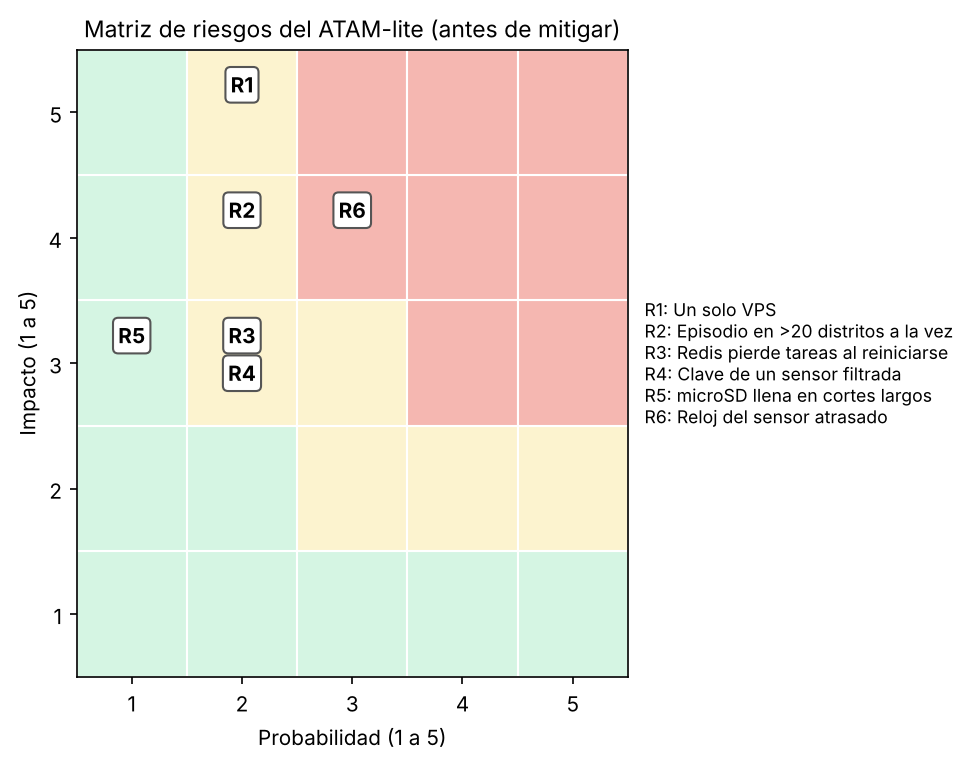

# Evaluación ATAM-lite — AireMisti IoT con 400 sensores (E3 y E7)

**Material evaluado:** [árbol de utilidad](utilidad/escenarios.md), iteraciones de ADD ([1](add/iteracion-1.md), [2](add/iteracion-2.md), [3](add/iteracion-3.md)), ADR-006 a ADR-008, vista de contenedores actualizada y resultados de [fitness/](../../fitness).

**Método:** se usó el Prompt IA 3 con la IA en el rol de **evaluador ATAM escéptico**. El equipo verificó cada hallazgo contra la evidencia: se aceptó, se mitigó o se refutó con datos.

> Actúa como evaluador ATAM escéptico. Te paso el árbol de utilidad, los ADR-006 a 008, la vista de contenedores y los resultados de las simulaciones y experimentos [pegar]. Para cada escenario (H,*) identifica puntos de sensibilidad, puntos de trade-off, riesgos y no riesgos. Para cada riesgo indica probabilidad e impacto (1 a 5) y una pregunta incómoda. No propongas rediseños completos; cita la evidencia que te falta.

## Puntos de sensibilidad
| ID | Hallazgo | Evidencia | Respuesta del equipo |
|---|---|---|---|
| S1 | El p95 de la alerta en vivo depende de cuántas alertas compiten por el canal de Telegram (20 mensajes/min). | Curva de la iteración 1: con el diseño anterior, más de 60 s desde 12 distritos con picos antiguos. | **Aceptado.** Por eso los picos antiguos no se publican (ADR-006); queda el caso de 29 distritos en vivo (R2). |
| S2 | Las lecturas perdidas al caer la ingesta dependen de `max_queued_messages` frente a 400 × minutos de caída. | Experimento real: 3000 perdidas con 1000; 0 con 200 000. | **Aceptado.** La FF-08 falla si la cola baja de 48 000 (2 h de caída). |
| S3 | La clasificación por frescura depende del reloj del sensor. | Sin evidencia previa: es una pregunta del evaluador. | **Aceptado y mitigado** (ver R6). |

## Puntos de trade-off
| ID | Hallazgo | Respuesta del equipo |
|---|---|---|
| T1 | Guardar en disco en cada cambio (fiabilidad del broker) frente al rendimiento: 5318 → 1595 mensajes/s con 20 000 en cola. | **Aceptado:** se guarda cada 60 s y el acuse de aplicación cubre la ventana (ADR-007). |
| T2 | Frescura (latencia de las alertas en vivo) frente a informar a la ciudadanía de un pico ocurrido durante el corte. | **Aceptado:** ese pico ya pasó; el analista lo recibe en la cola `historico` y decide si lo comunica. |
| T3 | Acuse de aplicación (cero pérdidas) frente a más tráfico y más trabajo en el firmware del sensor. | **Aceptado:** un mensaje por lote, 6,7 mensajes/s más en el peor caso. |

## Riesgos
| ID | Riesgo | P | I | Pregunta incómoda del evaluador | Respuesta del equipo |
|---|---|:---:|:---:|---|---|
| R1 | Un solo VPS es punto único de falla para QA-02 y QA-03. | 2 | 5 | "¿Qué pasa si el VPS no vuelve en 3 horas?" | **Aceptado** para el MVP: los sensores guardan en microSD y reenvían lo no confirmado (ADR-007), así que no se pierden lecturas, solo se retrasan. Respaldo diario de PostgreSQL. Un segundo VPS duplica el costo (R-03). |
| R2 | Si el episodio está en vivo en los 29 distritos a la vez, el canal vuelve a ser el límite. | 2 | 4 | "¿Cuántos distritos aguanta el canal?" | **Aceptado con umbral medido:** p95 de 46 s con 20 distritos y de 63 s con 29. Mitigación planificada en el ADR-006: agrupar alertas en un solo mensaje. |
| R3 | Redis sin AOF pierde las tareas encoladas si se reinicia. | 2 | 3 | "¿Una alerta puede desaparecer en un reinicio de Redis?" | **Aceptado:** la siguiente lectura en vivo del distrito (≤ 1 min después) vuelve a encolar la alerta. En el peor caso se retrasa 60 s y no se pierde. |
| R4 | Una clave de sensor filtrada permite enviar datos falsos de ese sensor. | 2 | 3 | "¿Cómo se detecta una alerta falsa?" | **Mitigado:** la ACL limita al propio tema (FF-11) y el analista puede retirar la alerta con una rectificación (Lab 05). mTLS queda para más de 1000 sensores (ADR-008). |
| R5 | La microSD se llena si un sensor pasa días sin acuse. | 1 | 3 | "¿Cuánto aguanta la microSD?" | **Aceptado:** el escenario exige 2 h (120 lecturas, unos 8 KB); la microSD guarda semanas. |
| R6 | Un sensor con el reloj atrasado más de 10 min marca sus lecturas en vivo como antiguas y su alerta no se publica. | 3 | 4 | "¿Los sensores sincronizan la hora? ¿Qué pasa si NTP falla?" | **Mitigado en el código:** un mensaje de una sola lectura siempre es en vivo, sin importar su hora (`test_lectura_en_vivo_con_reloj_atrasado_publica_la_alerta`). |

Los riesgos de la zona crítica (puntaje ≥ 12) eran solo R6, que quedó mitigado. R1 (10) y R2 (8) están en zona media y se aceptan con la justificación de la tabla.

## No riesgos
| ID | Decisión evaluada | Evidencia |
|---|---|---|
| N1 | El monolito modular con un solo proceso de ingesta soporta la reconexión de 400 sensores. | Lote de 120 lecturas en 2,4 ms en PostgreSQL 16 con 2,88 millones de filas; backlog de 48 000 lecturas en ~2,4 s (FF-06). |
| N2 | Mosquitto en el mismo VPS soporta 400 sensores. | 4700–5300 mensajes/s medidos frente a 6,7 mensajes/s de la red. |

## Falsos positivos de la IA refutados
| Afirmación del evaluador | Por qué se refutó |
|---|---|
| "Mosquitto no escala a 400 sensores; hay que migrar a un clúster EMQX." | Se pidió el dato y la IA no lo tenía. Medido: el broker acepta 4700–5300 mensajes/s y la red genera 6,7/s (factor de ~700). |
| "Con más workers de Celery se resuelve la latencia de las alertas." | La simulación da el mismo p95 con 2 y con 8 workers: el límite es el canal de Telegram. |
